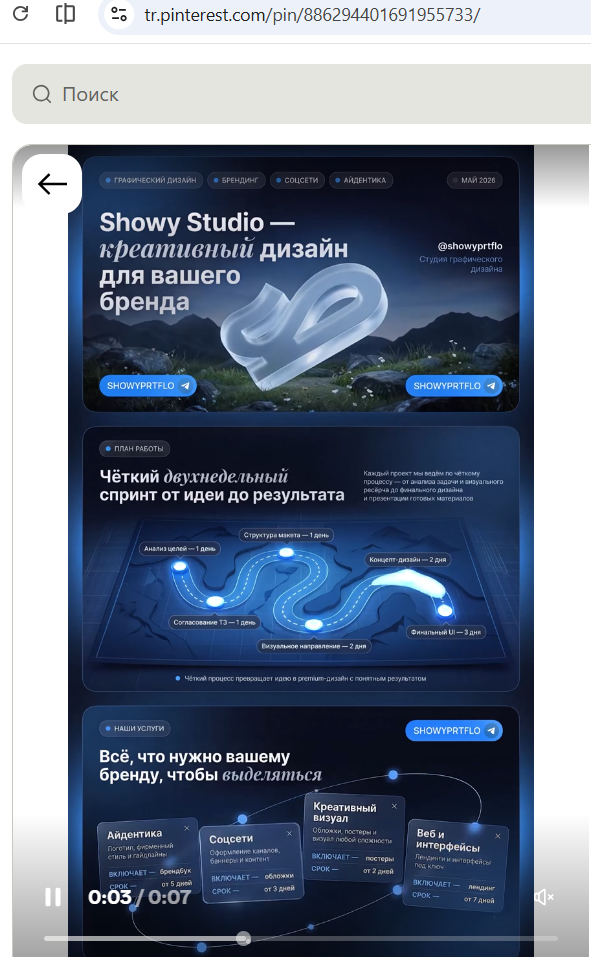

# Визуальное направление Telegram Mini App

Дата: 10.10.2026. Связь: D-10 в [ТЗ Mini App](telegram_mini_app_tz_v2.md), этап MA-0V в [плане](telegram_mini_app_plan.md).

**Основание:** пользователь предоставил [Pinterest-референс](https://pin.it/6N9UgDcq2) и скриншот. Зафиксировано пожелание ориентироваться на этот дизайн; конкретные макеты, точные цвета, шрифты и декоративные элементы ещё не утверждены. Пошаговый сценарий уже выбран отдельно.

Ссылка не открылась через доступный веб-просмотр. Анализ ниже относится к предоставленному скриншоту, а не к просмотренному видео или всем материалам страницы. Текст и кнопки браузера/Pinterest, стрелка назад поверх изображения и элементы видеоплеера не относятся к дизайну будущего приложения.

## 1. Что читается в референсе

- Почти чёрный и глубокий синий фон; крупные панели в синей гамме с мягкими градиентами.
- Холодный голубой свет, тонкие контуры и локальное свечение. Свет служит акцентом, а не равномерной заливкой всех элементов.
- Скруглённые прямоугольные карточки, слоистость и умеренная прозрачность, хорошо выраженные основные кнопки.
- Светлый крупный плотный заголовок, спокойный вторичный текст; отдельные слова в заголовке выделены декоративным курсивом.
- Небольшие подписи-метки с точкой; голубые кнопки-капсулы.
- Стеклянная объёмная фигура, светящаяся линия маршрута и орбитальные элементы создают образ технологичного продукта.

Референс — длинная презентационная страница студии. Mini App — короткий рабочий сценарий выбора и подтверждения встречи. Сохраняем визуальный язык, адаптируя плотность и размеры под действия пользователя.

## 2. Предлагаемая палитра для макетов

Значения ниже — стартовые приближения, выбранные по изображению; это не измеренные фирменные цвета автора и не утверждённые токены frontend. Контраст каждой пары проверяется в макетах/реализации; яркая кнопка не означает автоматически читаемый белый текст.

| Назначение | Стартовое значение | Применение |
|---|---|---|
| Основной фон | #080E20 | Основа тёмной темы |
| Поверхность карточки | #111D36 | Заявка, форма, блок настроек |
| Приподнятая поверхность | #1A3153 | Активная карточка/часть градиента |
| Основной акцент | #2E8FFF | Основная кнопка, выбор даты/слота |
| Световой акцент | #79D6FF | Тонкий контур, фокус, небольшой декоративный свет |
| Основной текст | #F2F5FC | Заголовки и важные данные |
| Вторичный текст | #B3C1D8 | Подписи, пояснения и неактивные метаданные |
| Граница | #304666 | Разделение тёмных поверхностей |

Успех, ошибка, предупреждение и ожидание имеют отдельные смысловые цвета/иконки с текстовыми подписями. Синее свечение не заменяет различие между «выбрано», «занято», «ошибка» и «подтверждено».

Основной демонстрационный вариант MA-0V — тёмный в духе референса. Совместимость со светлой темой Telegram сохраняется как требование: подготовить светлую адаптацию тех же карточек и акцентов. Приоритет пользовательской настройки темы/системной темы и необходимость переключателя согласовать на макетах; не навязывать всегда тёмный экран как уже принятое решение.

## 3. Как адаптировать к нашим экранам

| Часть приложения | Предлагаемое оформление | Ограничение удобства |
|---|---|---|
| Главная | Короткий светлый заголовок на глубоком синем, компактный световой акцент и две основные точки входа | Без большого пустого hero-блока, выдуманной фотографии и длинного рекламного текста |
| Пошаговая запись | Одна основная карточка, тонкий индикатор прогресса/голубые точки, компактный итог выбора | Декоративный «маршрут» из референса может стать небольшой линией прогресса; не отдельной 3D-картой на экран |
| Длительность/платформа | Компактные скруглённые варианты; выбранный отличается заливкой, контуром и текстом | Нет перекрывающихся или наклонённых карточек выбора |
| Даты/слоты | Хорошо читаемые кнопки с явным активным состоянием, умеренное свечение выбранного | Недоступное время не выглядит нажимаемым; края кнопок не выходят за экран |
| Контакты/цель | Тёмные поля с постоянными метками, светлый текст и заметный фокус | Никакой прозрачности, снижающей читаемость; ошибки у полей, а не только смена свечения |
| Итог | Спокойная карточка с ясной иерархией даты, времени, платформы и контактов | «Отправить заявку» остаётся главным действием; украшения не конкурируют с данными |
| Мои заявки | Вертикальные карточки одного ритма, номер/дата/статус, компактный фильтр | Без орбитального расположения и маленьких декоративных подписей |
| Админка | Тот же фон, карточки и кнопки; более высокая плотность информации | Контакты/сроки читаемы, ожидающие решения доступны сразу; без витрины декоративных счётчиков |

Блок подтверждения/ошибки может использовать небольшой знак/иллюстрацию, если она не вытесняет результат и действия. Сложные 3D-сцены, WebGL, фоновое видео и постоянно движущиеся орбиты не являются обязательными зависимостями первого релиза. Статические CSS/SVG-акценты или согласованный небольшой bitmap достаточны для передачи настроения.

## 4. Типографика, форма и движение

- Основной текст — простой читаемый шрифт с кириллицей. Название конкретного шрифта выбрать на макетах; числовые данные и подписи — без декоративного курсива.
- По уточнению пользователя от 10.10.2026 заголовок главной «Выберите время для разговора» — без курсива. Название «Планирование встреч» в шапке увеличено с 14 до 18 px; на узкой ширине допускается естественный перенос.
- Рабочий диапазон для макетов: текст полей 16 px, метки/вторичные данные 13–14 px, основные заголовки 22–28 px. При увеличении системного шрифта интерфейс остаётся рабочим.
- Карточки: стартовый радиус 16–20 px, поля/обычные кнопки 12–14 px; круглые кнопки-капсулы использовать избирательно. Точные токены утвердить после просмотра 320 px.
- Градиенты и тени неглубокие; текст располагается на достаточно непрозрачном слое. Подложка обеспечивает читаемость без обязательной загрузки фоновой картинки.
- Область нажатия минимум 44 × 44 CSS px; компактность не достигается уменьшением реальной зоны касания.
- Короткая анимация состояния/перехода возможна, но не задерживает форму. Учитывать reduced motion; нет обязательного мерцания и непрерывного пульсирования всего экрана.

## 5. Проверка попадания в направление

До основной UI-разработки показать главную, выбор слота, контакты, карточку заявки и админ-очередь в одном стиле; остальные репрезентативные экраны — по MA-0V. Сравнить:

1. Сохранились глубокий синий, голубой свет и мягкие карточки; это не стандартная форма с одной синей кнопкой.
2. Верхний декоративный блок не вытесняет полезное действие с первого мобильного экрана.
3. Текст не стал мелким, серым на синем или курсивным ради сходства с презентационной страницей.
4. Выбор, фокус, disabled, ошибка и успешное действие различимы по смыслу и подписи.
5. Светлая адаптация сохраняет узнаваемость и контраст; Telegram-панели не конфликтуют с фоном.
6. Длинные реальные названия шаблонов, даты, email и предупреждения помещаются на узком экране.
7. Тяжёлая иллюстрация/анимация не требуется для первого полезного экрана и не мешает доступности.

Результаты фиксировать в T-36/T-37/T-44. Пожелание использовать референс не означает согласования всех предложенных здесь чисел или конкретного макета.

## 6. Сохранённый источник

[Скриншот, предоставленный пользователем](design/pinterest_reference_2026-10-10.png) сохранён в документации, чтобы не зависеть от временного файла вложения. Он служит внутренним ориентиром; изображение страницы целиком, логотип Showy Studio, подписи, рекламные ссылки и 3D-объекты автора не являются готовыми ресурсами нашего интерфейса.

